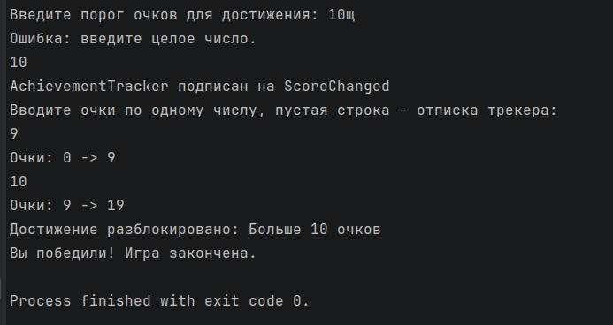

# КТ №22 — События: комплексное задание

**Вариант 2 — Система достижений**

- Класс `Player` с событиями `event EventHandler<(int OldScore, int NewScore)>? ScoreChanged` и `event EventHandler<string>? AchievementUnlocked` и методом `AddScore(int amount)`, обновляющим очки и вызывающим `ScoreChanged`.
- Класс `AchievementTracker` в конструкторе подписывается на `Player.ScoreChanged` и в своём обработчике проверяет, не превысили ли очки порог — если да, инициирует `Player.AchievementUnlocked` с названием достижения.
- На `Player.AchievementUnlocked` подписан отдельный обработчик, который выводит сообщение о разблокированном достижении.
- Цепочка событий: `ScoreChanged` → обработчик `AchievementTracker` → `AchievementUnlocked`.
- Отписка `AchievementTracker` от `Player.ScoreChanged`: после неё достижения больше не разблокируются.

Дополнительно: `Player` реализует интерфейс `IScoreSource`, трекер работает через него; ввод чисел — метод с делегатом `Action<int>`, ошибки ввода обрабатываются через `try`/`catch`; при разблокировке достижения выводится «Вы победили! Игра закончена.» и программа завершается.

## Проверочные ключи

Порог — `100`.

| Ввод | Ожидаемый результат |
|---|---|
| `60` | `Очки: 0 -> 60`, достижение не разблокировано |
| `50` | `Очки: 60 -> 110`, `Достижение разблокировано: Больше 100 очков`, `Вы победили! Игра закончена.` |
| `abc` | `Ошибка: введите целое число.` |
| `99999999999` | `Ошибка: слишком большое число.` |
| пустая строка (без победы) | `AchievementTracker отписан от ScoreChanged` |
| `200` после отписки | `Очки: ... -> ...`, достижение не разблокировано |

## Запуск

```
dotnet run
```

## Результат выполнения


